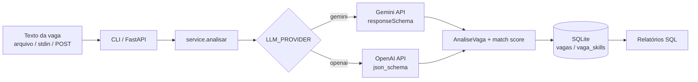

# Analisador de Vagas com IA


CLI em Python (com endpoint FastAPI opcional) que lê o texto de uma vaga de emprego, usa um LLM (**Google Gemini** ou **OpenAI**) com **saída JSON estruturada** para extrair as informações principais, calcula o quanto a vaga combina com as suas skills e guarda tudo em **SQLite** para gerar relatórios com **SQL**.

## Problema

Quem procura emprego lê dezenas de vagas com formatos diferentes. É difícil comparar rapidamente o que cada uma pede, saber o quanto você se encaixa e descobrir quais tecnologias o mercado mais pede. Este projeto automatiza essa leitura e transforma o texto livre em dados consultáveis.

## Funcionalidades

- Extração via LLM de: **título**, **senioridade**, **skills obrigatórias** e **skills desejáveis** (JSON Schema forçado na resposta).
- Provedor escolhido por variável de ambiente: `LLM_PROVIDER=gemini` ou `openai`.
- **Match score** (0–100) determinístico contra a sua lista de skills: obrigatórias pesam 80%, desejáveis 20%.
- Persistência em SQLite com `schema.sql` e consultas **parametrizadas** (sem ORM).
- Relatórios SQL: skills mais pedidas, vagas por senioridade com match médio, ranking de vagas.
- Entrada por arquivo ou `stdin`; API REST opcional com FastAPI.
- Testes com pytest (LLM simulado apenas nos testes), lint com ruff.

## Arquitetura



```
src/analisador_vagas/
├── cli.py       # comandos analisar / relatorio
├── api.py       # FastAPI opcional
├── service.py   # orquestração
├── llm.py       # clientes Gemini e OpenAI (REST via httpx)
├── models.py    # dataclass + cálculo de match
├── db.py        # SQL puro, parametrizado
└── schema.sql   # esquema do banco
```

## Instalação

```bash
git clone https://github.com/vagner67/analisador-vagas-ia.git
cd analisador-vagas-ia
python -m venv .venv && source .venv/bin/activate
pip install -e ".[api,dev]"
cp .env.example .env   # preencha sua chave
```

As chaves de API são lidas **somente do ambiente** e nunca devem ser commitadas (`.env` está no `.gitignore`). Carregue o `.env` no shell, por exemplo: `set -a; source .env; set +a`.

## Uso

```bash
# Analisar um arquivo
analisador-vagas analisar exemplos/vaga_exemplo.txt --skills "python,sql,git"

# Via stdin
cat vaga.txt | analisador-vagas analisar - --skills "python,sql"

# Só analisar, sem salvar
analisador-vagas analisar vaga.txt --nao-salvar
```

**Formato de saída (exemplo ilustrativo, não é um resultado real):**

```json
{
  "titulo": "Desenvolvedor(a) Python Júnior",
  "senioridade": "junior",
  "skills_obrigatorias": ["python", "sql", "git", "apis rest"],
  "skills_desejaveis": ["fastapi", "docker", "llm"],
  "match_score": 60.0,
  "id": 1
}
```

### Relatórios SQL

```bash
analisador-vagas relatorio top-skills --limite 5
analisador-vagas relatorio top-skills --so obrigatoria
analisador-vagas relatorio senioridade
analisador-vagas relatorio vagas
```

Consulta usada no relatório de skills mais pedidas:

```sql
SELECT skill, COUNT(DISTINCT vaga_id) AS vagas
FROM vaga_skills
WHERE (? IS NULL OR tipo = ?)
GROUP BY skill
ORDER BY vagas DESC, skill
LIMIT ?;
```

**Formato de saída (exemplo ilustrativo):**

```json
[
  {"skill": "python", "vagas": 3},
  {"skill": "sql", "vagas": 2}
]
```

### API (opcional)

```bash
uvicorn analisador_vagas.api:app --reload
curl -X POST localhost:8000/analisar -H "Content-Type: application/json" \
  -d '{"texto": "Vaga para dev Python júnior com SQL", "skills": ["python"]}'
curl localhost:8000/relatorios/top-skills
```

## Testes

```bash
pytest -v
ruff check . && ruff format --check .
```

Os testes usam um cliente LLM falso (`tests/conftest.py`) e mocks de HTTP, então não precisam de chave nem fazem chamadas reais. Em uso normal, com a chave definida, as chamadas às APIs são reais.

## Roadmap

- [ ] Normalização de sinônimos de skills (ex.: "postgres" × "postgresql")
- [ ] Importação de vagas a partir de URL
- [ ] Extração de faixa salarial e modalidade (remoto/híbrido)
- [ ] Dashboard simples com os relatórios
- [ ] Suporte a outros provedores/modelos locais

## Autor

**Vagner Pereira** — estudante de Ciência da Computação na Unic (Cuiabá-MT), desenvolvedor júnior com foco em Python, SQL e IA generativa.

[LinkedIn](https://www.linkedin.com/in/vagnerpereira-dev/) · [GitHub](https://github.com/vagner67)

## Licença

[MIT](LICENSE)
