# Job Posting Analyzer with AI — RAG · Tool-calling Agent · Evals

[](https://github.com/vagner67/analisador-vagas-ia/actions/workflows/ci.yml)


**Live demo:** https://analisador-vagas-ia.vercel.app (runs in labelled *offline mode*: no API key is configured on the demo)

**English** · [Português](#português)

Python + FastAPI service that turns free-text job postings into structured data with an LLM
(**Gemini** or **OpenAI**, structured JSON output via `httpx`), stores them in **SQLite**, and adds:

- **RAG** (`perguntar`): ask questions about the stored postings; answers **cite posting ids** (`[#id]`).
  Embeddings from the Gemini (`gemini-embedding-001`) or OpenAI (`text-embedding-3-small`) API, vectors cached in SQLite
  (`vaga_embeddings`). Without a key: pure-Python **TF-IDF** retrieval + extractive answer, labelled `offline`.
- **Agent with function calling** (`agente`): OpenAI `tools` / Gemini `functionDeclarations` loop with three tools:
  `buscar_vagas` (RAG search), `calcular_match`, `gerar_relatorio_sql`. Every tool call is returned in `passos`.
  Without a key: a deterministic regex router, labelled `offline`.
- **Evals**: hand-labelled dataset in `tests/evals/*.jsonl` → skill-extraction precision/recall/F1 and retrieval hit@k/MRR,
  enforced as regression floors in pytest and published in every CI run summary.
- **Docker** + docker-compose; **Vercel** serverless deploy; ruff + pytest + GitHub Actions.

No heavy dependencies (no torch / numpy / vector DB): runtime deps are `httpx` and `fastapi`.

## Architecture

```mermaid
flowchart LR
    U[User / Web demo / CLI] --> API[FastAPI · api/index.py on Vercel]
    API -->|/analisar| EX{API key?}
    EX -->|yes| LLM[Gemini / OpenAI<br/>structured JSON]
    EX -->|no| KW[Keyword extractor<br/>offline]
    LLM --> DB[(SQLite<br/>vagas · vaga_skills · vaga_embeddings)]
    KW --> DB
    API -->|/perguntar| RAG[RAG retriever]
    RAG -->|key| EMB[Embeddings API<br/>vectors cached in SQLite]
    RAG -->|no key| TF[TF-IDF offline]
    RAG --> GEN[LLM answer with &#91;#id&#93; citations<br/>or extractive offline answer]
    API -->|/agente| AG[Agent loop<br/>function calling / offline router]
    AG --> T1[buscar_vagas] --> RAG
    AG --> T2[calcular_match] --> DB
    AG --> T3[gerar_relatorio_sql] --> DB
    EV[Evals · tests/evals/*.jsonl] -.-> KW
    EV -.-> TF
```



## Run

```bash
pip install -e ".[dev]"
export GEMINI_API_KEY=...            # optional (or LLM_PROVIDER=openai + OPENAI_API_KEY)
analisador-vagas analisar exemplos/vaga_exemplo.txt --skills python,sql
analisador-vagas perguntar "Which postings require Kubernetes?"
analisador-vagas agente "Qual o match da vaga 2 se eu sei python, sql e spark?"
analisador-vagas relatorio top-skills
uvicorn analisador_vagas.api:app      # POST /analisar /perguntar /agente · GET /relatorios/top-skills /health
python -m analisador_vagas.evals --markdown
docker compose up --build             # http://localhost:8000 (DEMO_SEED=1 loads example postings)
```

## Eval results (offline mode, actual output of `python -m analisador_vagas.evals --markdown`)

| Eval (offline mode) | Metric | Value |
|---|---|---|
| Skill extraction (n=12 postings) | precision | 0.921 |
| | recall | 0.795 |
| | F1 | 0.853 |
| Retrieval (TF-IDF, n=14 queries) | hit@1 | 0.929 |
| | hit@3 | 0.929 |
| | MRR | 0.929 |

Dataset: 12 **hand-written, illustrative** postings (not scraped real ads) labelled manually, and 14 retrieval queries
(incl. 2 English queries against Portuguese text — the lexical TF-IDF baseline misses one of them, which is why
hit@k < 1). Keyword extraction misses skills outside its fixed vocabulary (e.g. dbt, Kafka, LangChain), hence recall 0.79.
LLM-mode evals require an API key and are not part of CI.

Live check (manual run on 2026-10-29 with `GEMINI_API_KEY`, `gemini-embedding-001` + `gemini-3.5-flash`):
"Quais vagas pedem Kubernetes?" → answer citing `[#7]` and `[#5]` (the two postings that list Kubernetes);
the agent called `calcular_match(vaga_id=2, skills=[python, sql, spark])` and answered 48 with Airflow/AWS missing.

---

# Português

**Demo ao vivo:** https://analisador-vagas-ia.vercel.app (modo offline rotulado, sem chave de API)

Serviço Python + FastAPI que transforma vagas em dados estruturados com LLM (Gemini ou OpenAI), salva em SQLite e oferece:

- **RAG** (`perguntar`): perguntas sobre as vagas salvas, com **citação dos ids** das vagas (`[#id]`). Embeddings via API
  (Gemini/OpenAI) com vetores cacheados no SQLite; sem chave, **TF-IDF** em Python puro + resposta extrativa (rotulado *offline*).
- **Agente com function calling** (`agente`): ferramentas `buscar_vagas`, `calcular_match`, `gerar_relatorio_sql`;
  sem chave, roteador determinístico por regex (rotulado). Cada chamada de ferramenta aparece em `passos`.
- **Evals**: dataset rotulado à mão em `tests/evals/` com precisão/recall de extração de skills e hit@k/MRR de recuperação,
  verificados no pytest e publicados no resumo de cada execução do CI (tabela acima, números reais).
- **Docker/docker-compose**, deploy **Vercel**, ruff, pytest e GitHub Actions.

Como rodar: veja a seção *Run* acima (os comandos são os mesmos). O match score é determinístico:
skills obrigatórias pesam 80% e desejáveis 20%. Sem chave de API, nenhuma resposta finge ser de LLM: o campo `modo` indica
`offline`.

Licença MIT.
